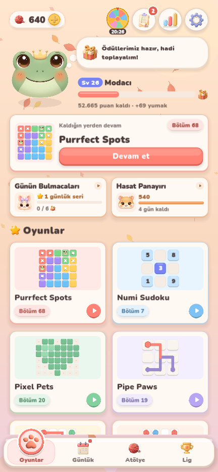
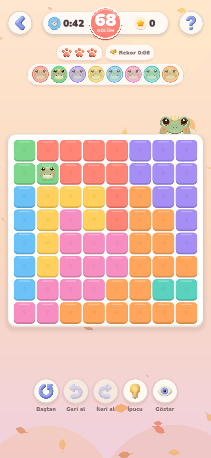

# Puzzumi | Mobil Bulmaca Oyunu

Godot ile geliştirdiğim, sevimli hayvan karakterleriyle altı farklı bulmaca türünü tek uygulamada toplayan Android bulmaca oyunu.

  
  
  

## Hakkında

Puzzumi, Godot Engine ile sıfırdan geliştirdiğim bir mobil bulmaca oyunu. Purrfect Spots, Numi Sudoku, Pixel Pets (nonogram) ve Pipe Paws gibi altı farklı bulmaca türünü, sevimli hayvan karakterleri ve sıcak sonbahar temalı bir arayüzle bir araya getiriyor.

- Bölümleri geçtikçe seviye atlama, yumak toplama ve dönemsel etkinlikler
- Günlük bulmacalar ve seri takibi
- Her bölümde süre ve rekor takibi, geri al / ileri al, ipucu ve çözümü göster araçları
- Türkçe ve İngilizce dil desteği, günlük hatırlatma bildirimleri
- AdMob reklam ve uygulama içi satın alma altyapısı; Google Play'de yayına hazırlanıyor

## Teknolojiler

Godot · GDScript · Android · AdMob

---

> Bu depo yalnızca projenin tanıtımı içindir; kaynak kodu paylaşılmamaktadır.
