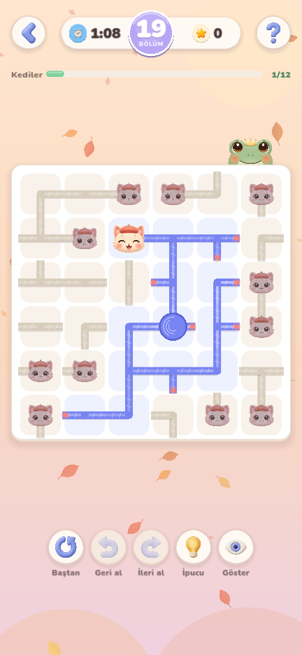

# 🧶 Puzzumi

### Sevimli dostlarla altı bulmaca, tek oyun

Godot ile sıfırdan geliştirdiğim, sıcak sonbahar temalı mobil bulmaca oyunu

 

&nbsp;&nbsp;

&nbsp;&nbsp;

Ana ekran · Purrfect Spots · Pipe Paws

---

## 📖 Hakkında

**Puzzumi**, kısa molalarda açıp birkaç dakika oynanabilecek, ama derinleştikçe insanı içine çeken bir bulmaca koleksiyonu. Altı farklı bulmaca türünü tek bir uygulamada topluyor; her oyunun kendi kedisi, rengi ve kuralı var. Kurbağa maskotumuz ana ekranda oyuncuyu karşılıyor, ödülleri hatırlatıyor ve ilerlemeyi takip ediyor.

Oyunun tüm görsel kimliğini, arayüzünü ve oyun mantığını Godot Engine ve GDScript ile kendim tasarlayıp kodladım. Hedefim; yumuşak renkler, sevimli karakterler ve rahatlatıcı bir sonbahar atmosferiyle "bir bölüm daha" dedirten bir deneyim oluşturmaktı.

## 🎮 Oyunlar

| | Oyun | Nasıl oynanır |
|:-:|---|---|
| 🐱 | **Purrfect Spots** | Her renk bölgesine, her satıra ve her sütuna tam bir kedi yerleştir |
| 🔢 | **Numi Sudoku** | Klasik rakam bulmacası, sevimli bir dokunuşla |
| 🐾 | **Pixel Pets** | Nonogram: ipuçlarını takip ederek karelerin arkasına gizlenmiş dostları ortaya çıkar |
| 🧶 | **Pipe Paws** | Yolları birleştirerek her kediyi yumağa bağla |
| 🪡 | **Thread Knot** | Eş düğmeleri iplikle birbirine dik |
| 🔘 | **Button Pairs** | Satırları eşit doldur; yan yana üç aynı düğme olmasın |

## ✨ Öne çıkan özellikler

<table>
<tr>
<td width="50%" valign="top">

**🎯 Oynanış**
- Her bölümde süre ve rekor takibi
- Geri al / ileri al, ipucu ve çözümü göster
- İpuçları sadece cevabı vermez, mantığını adım adım anlatır
- Kaldığın yerden tek dokunuşla devam
- Oyuncunun performansına göre kendini ayarlayan dinamik zorluk

</td>
<td width="50%" valign="top">

**📅 Her gün yeni bir şey**
- Günün bulmacaları ve seri takibi
- Geçmiş günlerin bulmaca arşivi
- Haftalık görevler ve dönemsel etkinlikler
- Akşam hatırlatma bildirimleri

</td>
</tr>
<tr>
<td width="50%" valign="top">

**🏆 İlerleme ve ödül**
- Puan topladıkça yükselen terzi rütbeleri
- Yumak para birimi ve şans çarkı
- Lig sıralaması
- Yorgan Defteri ve peluş siparişleri koleksiyonu

</td>
<td width="50%" valign="top">

**🌍 Herkes için**
- Türkçe ve İngilizce dahil 16 dil
- Hesap gerektirmez, ilerleme cihazda saklanır
- Ses seçimi ve kişiselleştirilebilir ayarlar
- Sonuçları paylaşmak için skor kartı

</td>
</tr>
</table>

## 🛠️ Teknik yapı

| Alan | Kullanılan |
|---|---|
| Oyun motoru | Godot 4 |
| Dil | GDScript |
| Platform | Android |
| Gelir modeli | Google AdMob reklamları, uygulama içi "reklamları kaldır" satın alımı |
| Veri | Hesapsız, cihazda yerel kayıt |
| Yerelleştirme | 16 dil, CSV tabanlı çeviri |

---

🔒 Bu depo yalnızca projenin tanıtımı içindir; kaynak kodu paylaşılmamaktadır.

**[tetik.dev](https://tetik.dev/projects.html)** · Muhammed Ali Tetik

